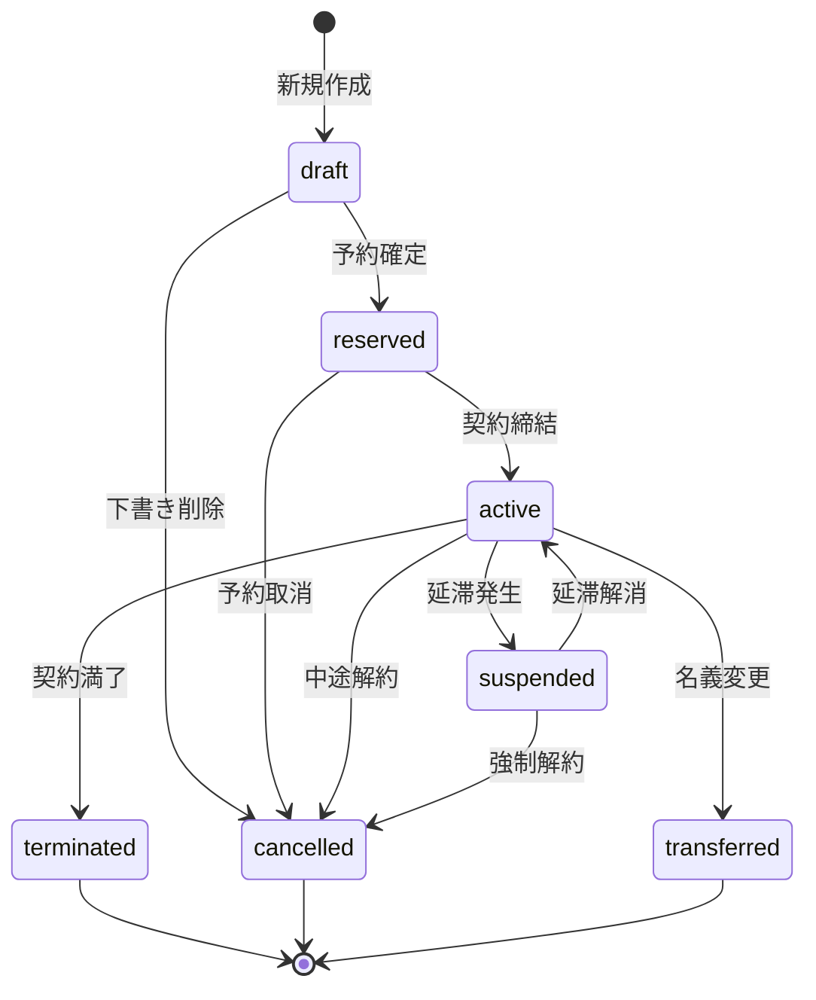

# 契約ライフサイクル設計書

作成日: 2026-01-31
Phase: 9.1 契約管理ロジック

---

## 1. 現状分析

### 1.1 既存のステータス定義

現在、契約に関連するステータスは以下の3つが存在する：

| Enum | 対象モデル | 値 |
|------|-----------|-----|
| PaymentStatus | ContractPlot | unpaid, partial_paid, paid, overdue, refunded, cancelled |
| PhysicalPlotStatus | PhysicalPlot | available, partially_sold, sold_out |
| BillingStatus | CollectiveBurial | pending, billed, paid |

### 1.2 現状の問題点

1. **契約状態と支払状態の混同**
   - `PaymentStatus.cancelled` は支払いではなく契約のキャンセル
   - 契約全体のライフサイクルを表すステータスがない

2. **契約フェーズの表現不足**
   - 仮契約・本契約の区別がない
   - 契約終了・解約の管理ができない
   - 継承（名義変更）の状態管理がない

3. **状態遷移ルールの未定義**
   - どの状態からどの状態に遷移可能かが明確でない
   - 状態変更時のバリデーションがない

---

## 2. 契約ステータス設計

### 2.1 新規Enum: ContractStatus

```prisma
enum ContractStatus {
  draft           // 下書き・仮予約
  reserved        // 予約済み（仮契約）
  active          // 有効（本契約）
  suspended       // 一時停止（滞納等）
  terminated      // 終了（正常終了）
  cancelled       // 解約（中途解約）
  transferred     // 継承済み（名義変更完了）
}
```

### 2.2 ステータス詳細定義

| ステータス | 日本語 | 説明 | 主な用途 |
|-----------|--------|------|---------|
| `draft` | 下書き | 契約情報入力中、未確定 | 新規登録時の仮保存 |
| `reserved` | 予約済 | 区画予約完了、契約書未発行 | 仮契約・抽選当選後 |
| `active` | 有効 | 本契約締結済み、利用可能 | 通常の契約状態 |
| `suspended` | 停止中 | 支払い延滞等で一時停止 | 滞納時の利用制限 |
| `terminated` | 終了 | 契約期間満了による終了 | 正常な契約終了 |
| `cancelled` | 解約 | 契約者都合による中途解約 | キャンセル・返金対応 |
| `transferred` | 継承済 | 名義変更により別契約へ移行 | 相続・名義変更 |

---

## 3. 状態遷移図

```
                                    ┌─────────────┐
                                    │   draft     │
                                    │  (下書き)   │
                                    └──────┬──────┘
                                           │ 予約確定
                                           ▼
                                    ┌─────────────┐
                              ┌─────│  reserved   │─────┐
                              │     │ (予約済み)  │     │
                              │     └──────┬──────┘     │
                              │            │            │
                         予約取消        契約締結       │
                              │            │            │
                              │            ▼            │
                              │     ┌─────────────┐     │
                              │     │   active    │◄────┼─── 復帰
                              │     │   (有効)    │     │    (支払完了)
                              │     └──────┬──────┘     │
                              │            │            │
                              │     ┌──────┼──────┐     │
                              │     │      │      │     │
                              │  滞納   継承   解約  満了│
                              │     │      │      │     │
                              │     ▼      │      ▼     │
                              │  ┌──────┐  │  ┌──────┐  │
                              │  │suspended│ │  │cancelled
                              │  │(停止中)│  │  │(解約)│  │
                              │  └──────┘  │  └──────┘  │
                              │            │            │
                              │            ▼            ▼
                              │     ┌─────────────┐  ┌─────────────┐
                              └────►│ transferred │  │ terminated  │
                                    │ (継承済み)  │  │  (終了)     │
                                    └─────────────┘  └─────────────┘
```

---

## 4. 状態遷移ルール

### 4.1 許可される遷移

| From | To | 条件 | アクション |
|------|-----|------|-----------|
| `draft` | `reserved` | 区画選択完了、顧客情報入力済み | 予約番号発行 |
| `draft` | `cancelled` | ユーザーが下書き削除 | 論理削除 |
| `reserved` | `active` | 契約書署名、許可証発行 | 契約日・許可日設定 |
| `reserved` | `cancelled` | 予約取消（期限切れ含む） | 区画を利用可能に戻す |
| `active` | `suspended` | 支払い延滞（overdue） | 延滞通知送付 |
| `active` | `terminated` | 契約期間満了 or 返還 | 終了日設定 |
| `active` | `cancelled` | 契約者都合による解約 | 返金処理 |
| `active` | `transferred` | 名義変更・相続完了 | 新契約作成、旧契約クローズ |
| `suspended` | `active` | 延滞解消（全額入金） | 停止解除 |
| `suspended` | `cancelled` | 長期延滞による強制解約 | 強制解約処理 |

### 4.2 禁止される遷移

以下の遷移は**禁止**（バリデーションエラー）：

- `terminated` → 任意: 終了した契約は変更不可
- `cancelled` → 任意: 解約した契約は変更不可
- `transferred` → 任意: 継承済みの契約は変更不可
- `active` → `draft`: 本契約から下書きへは戻せない
- `active` → `reserved`: 本契約から予約へは戻せない

---

## 5. PaymentStatus との関係

### 5.1 ステータス連動ルール

| ContractStatus | 許可されるPaymentStatus |
|----------------|------------------------|
| `draft` | unpaid のみ |
| `reserved` | unpaid, partial_paid |
| `active` | unpaid, partial_paid, paid |
| `suspended` | overdue のみ |
| `terminated` | paid, refunded |
| `cancelled` | refunded, cancelled |
| `transferred` | paid |

### 5.2 自動遷移トリガー

| イベント | PaymentStatus変更 | ContractStatus変更 |
|---------|------------------|-------------------|
| 延滞発生（期限超過） | → `overdue` | → `suspended` |
| 延滞解消（全額入金） | → `paid` | → `active` |
| 返金処理 | → `refunded` | → `cancelled` |

---

## 6. 各状態で許可される操作

### 6.1 操作マトリクス

| 操作 | draft | reserved | active | suspended | terminated | cancelled | transferred |
|-----|-------|----------|--------|-----------|------------|-----------|-------------|
| 基本情報編集 | ○ | ○ | ○ | ○ | × | × | × |
| 顧客情報変更 | ○ | ○ | ○ | △ | × | × | × |
| 支払い登録 | × | ○ | ○ | ○ | × | × | × |
| 請求書発行 | × | ○ | ○ | ○ | × | × | × |
| 埋葬者追加 | × | × | ○ | × | × | × | × |
| 名義変更 | × | × | ○ | × | × | × | × |
| 解約申請 | × | ○ | ○ | ○ | × | × | × |
| 削除 | ○ | × | × | × | × | × | × |

※ △ = 制限付き（管理者のみ等）

---

## 7. 実装計画

### 7.1 Phase 1: スキーマ変更

1. `ContractStatus` enumの追加
2. `ContractPlot` に `contract_status` フィールド追加
3. 既存データのマイグレーション
   - `payment_status = cancelled` → `contract_status = cancelled`
   - その他 → `contract_status = active`

### 7.2 Phase 2: バリデーション実装

1. 状態遷移バリデーションサービスの作成
2. コントローラーへのバリデーション組み込み
3. 操作権限チェックの追加

### 7.3 Phase 3: 自動遷移ロジック

1. 延滞検知バッチ処理
2. 契約期間満了チェック
3. 状態変更時の通知機能

---

## 8. データマイグレーション計画

### 8.1 既存データの移行ルール

```sql
-- 既存契約のマイグレーション
UPDATE contract_plots
SET contract_status = CASE
  WHEN payment_status = 'cancelled' THEN 'cancelled'
  WHEN payment_status = 'refunded' THEN 'cancelled'
  WHEN payment_status = 'overdue' THEN 'suspended'
  WHEN deleted_at IS NOT NULL THEN 'cancelled'
  ELSE 'active'
END;
```

### 8.2 PaymentStatusの整理

`cancelled` を `PaymentStatus` から削除し、契約キャンセル時は：
- `ContractStatus` → `cancelled`
- `PaymentStatus` → `refunded` または そのまま維持

---

## 9. 次のステップ

1. [ ] この設計書のレビュー・承認
2. [ ] Prismaスキーマ変更の実装
3. [ ] マイグレーションスクリプトの作成
4. [ ] バリデーションサービスの実装
5. [ ] 単体テストの作成
6. [ ] フロントエンドへの反映

---

## 付録: 状態遷移図（Mermaid形式）


